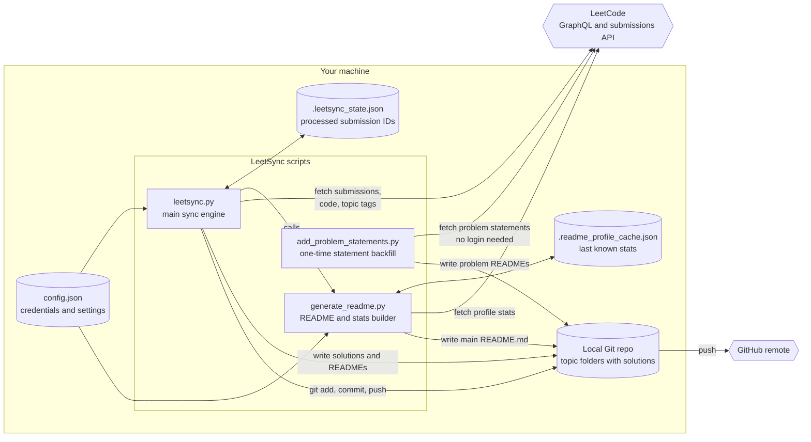
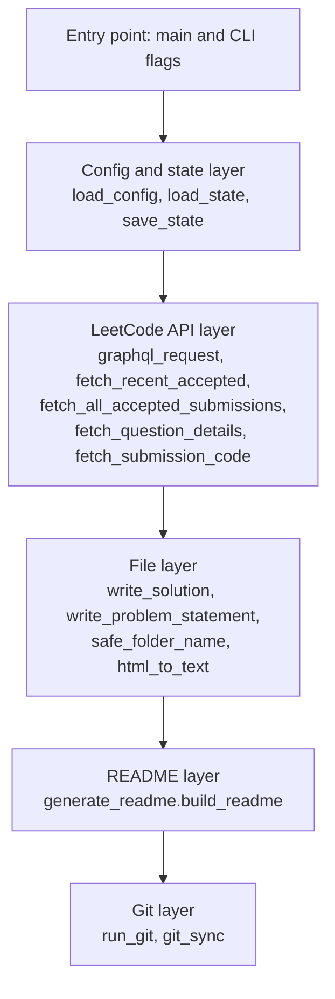
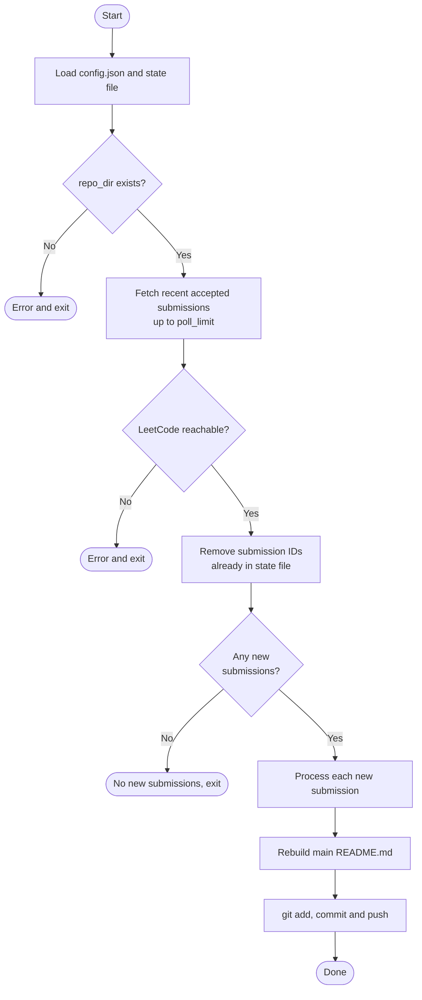
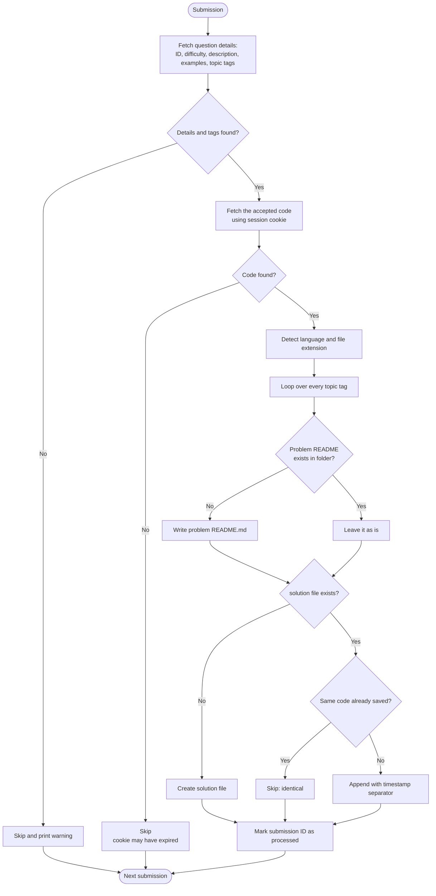
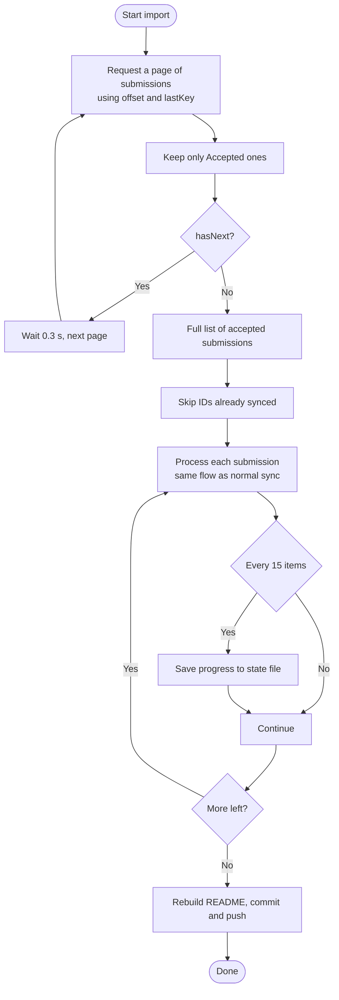
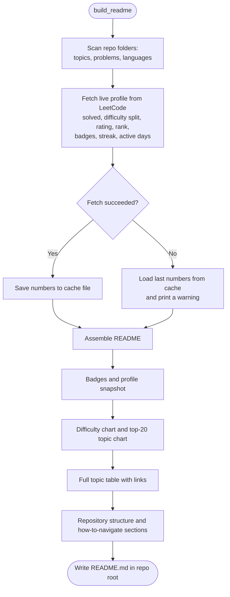
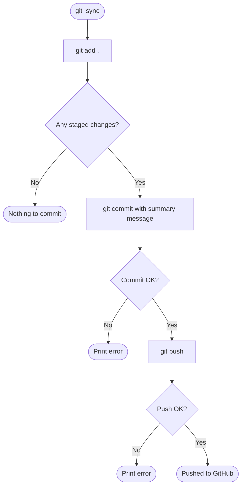
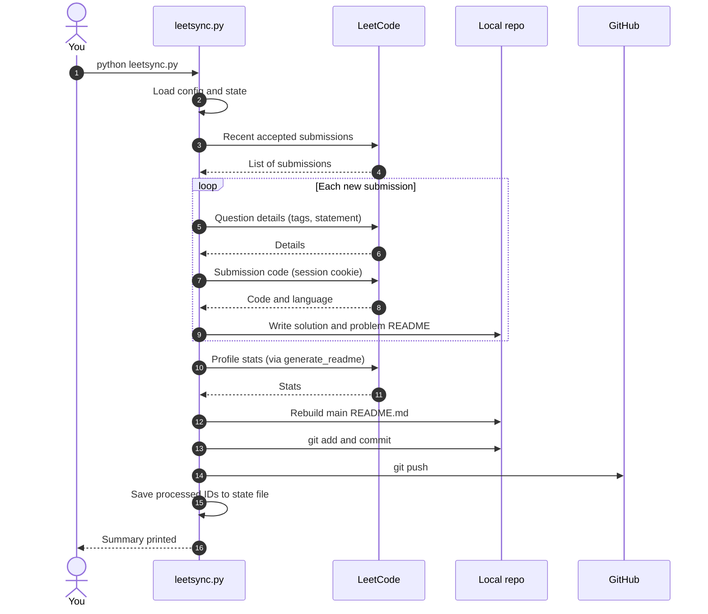

# LeetSync: LeetCode to GitHub Auto-Sync

A Python tool that automatically saves your **accepted LeetCode solutions** into a **topic-wise folder structure** in a local Git repository, then **commits and pushes** them to GitHub. It also generates a README for every problem and keeps a **live-stats README** for your whole solutions repo up to date.


-brightgreen)


---

## Table of Contents

- [Overview](#overview)
- [Features](#features)
- [Architecture](#architecture)
- [Flow Diagrams](#flow-diagrams)
- [Output Structure](#output-structure)
- [Getting Started](#getting-started)
- [Configuration](#configuration)
- [Usage](#usage)
- [Automating with a Scheduler](#automating-with-a-scheduler)
- [How It Works in Detail](#how-it-works-in-detail)
- [Security Notes](#security-notes)
- [Troubleshooting](#troubleshooting)
- [Limitations](#limitations)
- [Future Improvements](#future-improvements)
- [Tech Stack](#tech-stack)
- [Author](#author)

---

## Overview

Keeping LeetCode solutions on GitHub by hand is slow: copy the code, pick a folder, write a README, commit, push. **LeetSync does all of that for you.**

After you solve problems on LeetCode, run one command. LeetSync will:

1. Find your newly accepted submissions
2. Download the code and look up each problem's **topic tags**
3. Save the solution into the right topic folder(s)
4. Create a README with the problem statement and examples
5. Rebuild the repo's main README with your latest LeetCode stats
6. Commit and push everything to GitHub

It uses only Python's **standard library**, so there is nothing to install.

---

## Features

| Feature | Description |
|---------|-------------|
| **Topic-wise organisation** | Each solution is filed under every topic tag of the problem (Array, Dynamic Programming, Graph, and so on). |
| **Auto commit and push** | New solutions are committed with a descriptive message and pushed to your GitHub remote. |
| **Duplicate protection** | Tracks processed submission IDs, so each submission is handled once. Identical code is never saved twice. |
| **Re-solve support** | If you solve a problem again with different code, the new version is appended to the same file with a timestamp separator. |
| **Full history import** | `--import-history` walks your **entire** submission history (not just the latest ~20) and resumes safely if interrupted. |
| **Problem README per folder** | Title, difficulty, link, description, example test cases and an "Approach" section for your own notes. |
| **Backfill mode** | `--backfill` adds missing problem READMEs to folders synced earlier. |
| **Auto-generated main README** | Badges, profile snapshot (solved, Easy/Medium/Hard, contest rating, streak), difficulty chart, top-20 topic chart and a full topic table. |
| **Multi-language support** | Handles C++, Java, Python, JavaScript, TypeScript, Go, Rust, SQL and many more, with the right file extension and comment style. |
| **Safe and resumable** | Progress is saved every 15 problems. README or API problems never break the sync itself. |
| **Scheduler friendly** | Safe to run repeatedly, so it works well with Windows Task Scheduler or cron. |

---

## Architecture

LeetSync is made up of three scripts that share one configuration file and one state file. It talks to two external systems: **LeetCode** (to read data) and **GitHub** (through your local Git).



### Components

| File | Role |
|------|------|
| `leetsync.py` | The main engine. Fetches new accepted submissions, downloads code and tags, writes solution files, handles dedup state, and runs Git. Supports the `--readme`, `--backfill` and `--import-history` modes. |
| `generate_readme.py` | Scans the repo, counts problems per topic and language, fetches your live LeetCode profile numbers, and writes the main `README.md` with badges, charts and a topic table. Falls back to cached numbers if LeetCode is unreachable. |
| `add_problem_statements.py` | Standalone one-time script that adds a `README.md` (statement, difficulty, examples) to existing problem folders. Uses only public data, so no login is needed. |
| `config.json` | Your username, session cookie, CSRF token, repo path and settings. **Never commit this file.** |
| `.leetsync_state.json` | List of submission IDs already processed, so nothing is repeated. |
| `.readme_profile_cache.json` | Last successfully fetched profile stats, used if LeetCode can't be reached. |

### Layered view



---

## Flow Diagrams

### 1. Normal sync flow (`python leetsync.py`)



### 2. Processing one submission



### 3. Full history import (`--import-history`)



If the import is interrupted (network problem, rate limit), run the same command again. It resumes from the saved progress.

### 4. README generation flow



### 5. Git sync flow



### 6. Sequence of a typical run



---

## Output Structure

Solutions are organised as `Topic / ID-problem-slug / files`. A problem with several topic tags is saved in **each** matching topic folder.

```
leetcode_solutions/
├── README.md                          # auto-generated: stats, charts, topic table
├── Array/
│   ├── 1-two-sum/
│   │   ├── solution.cpp               # your accepted code
│   │   └── README.md                  # problem statement, examples, approach notes
│   └── 53-maximum-subarray/
│       ├── solution.java
│       └── README.md
├── Hash Table/
│   └── 1-two-sum/
│       ├── solution.cpp
│       └── README.md
├── Dynamic Programming/
│   └── ...
└── ...
```

### Re-solved problems

If you solve the same problem again with different code, the new version is **appended** to the same solution file:

```
<your first accepted solution>

// ---- submission 2026-11-02 18:30:12 ----

<your second accepted solution>
```

Identical code is never added twice.

---

## Getting Started

### Prerequisites

- **Python 3.8 or newer** (no extra packages needed)
- **Git**, installed and configured with push access to your GitHub repo
- A **LeetCode account** with some accepted submissions
- A **GitHub repository** for your solutions, cloned locally

### Step 1: Prepare your solutions repo

If you already have a repo, make sure it is connected to GitHub:

```bash
git remote -v
```

If it is a brand new folder:

```bash
git init
git remote add origin https://github.com/<your-username>/<your-solutions-repo>.git
git branch -M main
```

### Step 2: Get the tool

```bash
git clone https://github.com/<your-username>/<leetsync-repo>.git
cd <leetsync-repo>
```

### Step 3: Create `config.json`

Create a file named `config.json` next to `leetsync.py`. See [Configuration](#configuration).

### Step 4: Protect your secrets

Add these lines to the `.gitignore` of **both** this tool's repo and your solutions repo:

```
config.json
.leetsync_state.json
.readme_profile_cache.json
```

### Step 5: Run it

```bash
python leetsync.py
```

---

## Configuration

Create `config.json` in the same folder as `leetsync.py`:

```json
{
  "leetcode_username": "your_leetcode_username",
  "leetcode_session": "PASTE_LEETCODE_SESSION_COOKIE_HERE",
  "csrf_token": "PASTE_CSRFTOKEN_COOKIE_HERE",
  "repo_dir": "C:\\path\\to\\your\\solutions\\repo",
  "poll_limit": 20
}
```

| Key | Required | Description |
|-----|----------|-------------|
| `leetcode_username` | Yes | Your LeetCode username. |
| `leetcode_session` | Yes | Value of the `LEETCODE_SESSION` cookie (used to download your code). |
| `csrf_token` | Yes | Value of the `csrftoken` cookie. |
| `repo_dir` | Yes | Path to your local solutions repo (must already be a Git repo with a GitHub remote). On Windows, use double backslashes. |
| `poll_limit` | No | How many recent accepted submissions to check on a normal run. Default `20`. |
| `update_readme` | No | Set to `false` to stop the main README from being rebuilt automatically. Default `true`. |

### How to get the cookies

1. Log in to [leetcode.com](https://leetcode.com) in Chrome, Edge or Firefox.
2. Press `F12` to open DevTools.
3. Go to **Application** (Chrome/Edge) or **Storage** (Firefox), then **Cookies**, then `https://leetcode.com`.
4. Copy the value of `LEETCODE_SESSION` into `leetcode_session`.
5. Copy the value of `csrftoken` into `csrf_token`.

> **Important:** The `LEETCODE_SESSION` cookie works like a password for your LeetCode account. Never share it, never commit it, and never post screenshots of it. It also expires after some days or weeks, and you will need to copy a fresh one when that happens.

---

## Usage

| Command | What it does |
|---------|--------------|
| `python leetsync.py` | Normal sync. Checks your recent accepted submissions and syncs the new ones. |
| `python leetsync.py --import-history` | One-time import of your **entire** accepted submission history. Can take several minutes for large histories, and is safe to re-run if interrupted. |
| `python leetsync.py --backfill` | Adds a `README.md` to every problem folder that doesn't have one, then rebuilds the main README, commits and pushes. |
| `python leetsync.py --readme` | Only rebuilds the main README.md (no new solutions), then commits and pushes. |
| `python generate_readme.py` | Rebuilds the main README using `repo_dir` from the config. |
| `python generate_readme.py --offline` | Rebuilds the README without contacting LeetCode (uses cached stats). |
| `python add_problem_statements.py <repo-path>` | Standalone backfill of problem statements. No login needed. |

### Typical workflow

```bash
# First time only: bring in everything you have already solved
python leetsync.py --import-history

# Every time after solving new problems
python leetsync.py
```

### Example console output

```
Checking recent accepted submissions for 'your_username'...
Found 2 new accepted submission(s).

Processing: Two Sum (two-sum) [submission 123456789]
  -> F:\leet_solutions\Array\1-two-sum\README.md
  -> F:\leet_solutions\Array\1-two-sum\solution.cpp
  -> F:\leet_solutions\Hash Table\1-two-sum\README.md
  -> F:\leet_solutions\Hash Table\1-two-sum\solution.cpp

Updating README.md...

Committing and pushing to GitHub...
Pushed to GitHub.
```

---

## Automating with a Scheduler

Because LeetSync is safe to run repeatedly (it skips anything already processed), you can schedule it to run every 15 to 30 minutes.

### Windows Task Scheduler

1. Open **Task Scheduler**, then **Create Basic Task**.
2. Trigger: **Daily**, then edit it to **repeat every 30 minutes**.
3. Action: **Start a program**
   - Program: `python`
   - Arguments: `leetsync.py`
   - Start in: the folder containing `leetsync.py`

### Linux / macOS (cron)

```bash
*/30 * * * * cd /path/to/leetsync && /usr/bin/python3 leetsync.py >> sync.log 2>&1
```

When the session cookie expires, scheduled runs will print an error. Refresh the cookie in `config.json` and it will continue working.

---

## How It Works in Detail

### 1. Finding new submissions

- **Normal run:** calls LeetCode's `recentAcSubmissionList` GraphQL query for your latest accepted submissions.
- **History import:** calls the authenticated `submissionList` query and pages through everything using `offset` and `lastKey`, keeping only entries with status `Accepted`.

### 2. Avoiding duplicates

LeetSync keeps a list of **submission IDs** in `.leetsync_state.json`. Using IDs (instead of problem names) means that solving a problem again later is correctly detected as new, while old submissions are never refetched.

### 3. Topic folders

For each submission, LeetSync reads the problem's `topicTags` (for example *Array*, *Hash Table*) and writes the solution into one folder per tag. Folder names are cleaned of characters that are illegal in file names.

### 4. Language handling

The language reported by LeetCode is mapped to a file extension (for example `cpp` to `.cpp`, `python3` to `.py`, `mysql` to `.sql`) and a comment prefix used for the separator when multiple versions are appended. Unknown languages are saved as `.txt`.

### 5. Problem statement README

For each new problem folder, a `README.md` is created containing the title, difficulty, link, description (converted from HTML to text), example test cases, and an **Approach** section left for your own notes. It is written only once and never overwritten.

### 6. Main README generation

`generate_readme.py` scans the repo to count problems per topic and languages used, fetches live profile data (solved count, difficulty split, contest rating, rank, badges, active days, longest streak), and builds a README with badges, charts and a linked topic table. If LeetCode can't be reached, it falls back to the last cached numbers.

### 7. Git automation

After files are written, LeetSync runs `git add .`, checks whether anything is staged, commits with a message like `Sync 3 submission(s): two-sum, add-two-numbers, ...` and runs `git push`.

### 8. Resilience

- Progress is saved to the state file every 15 submissions during long imports.
- A short delay between requests keeps traffic gentle.
- Failures on one submission (network error, missing code) are reported and skipped without stopping the whole run.
- A README failure never blocks the sync.

---

## Security Notes

- **`config.json` contains your LeetCode session cookie.** Treat it like a password.
- Keep `config.json`, `.leetsync_state.json` and `.readme_profile_cache.json` in `.gitignore`, and never upload them to GitHub or share them in zip files.
- If you ever expose your cookie, **log out of LeetCode on all devices** (Settings, Sessions) to invalidate it, then copy a fresh one.
- The tool only reads from LeetCode. It never submits code or changes anything on your LeetCode account.

---

## Troubleshooting

| Problem | Likely cause and fix |
|---------|----------------------|
| `config.json not found` | Create `config.json` in the same folder as `leetsync.py`. |
| `repo_dir does not exist` | Check the path in `config.json`. On Windows, use double backslashes (`F:\\leet_solutions`). |
| `could not fetch code (session cookie may have expired)` | Copy a fresh `LEETCODE_SESSION` and `csrftoken` from your browser into `config.json`. |
| `could not reach LeetCode` | Check your internet connection, or try again later (rate limit). |
| `git push failed` | Make sure the repo has a remote (`git remote -v`) and that you are logged in to Git/GitHub. |
| `unrecognized language ... saving as .txt` | The language isn't in the extension table. Add it to `LANG_EXT` in `leetsync.py`. |
| README not updated | Make sure `generate_readme.py` is in the same folder as `leetsync.py`, and that `update_readme` isn't set to `false`. |
| Import stopped midway | Re-run `python leetsync.py --import-history`. It resumes from the saved progress. |

---

## Limitations

- Downloading your code and walking your full history use **undocumented LeetCode endpoints**. LeetCode may change them, which could break parts of the tool.
- The session cookie **expires** and must be refreshed manually.
- LeetCode doesn't expose editorials or approach write-ups through its public API, so the **Approach** section in each problem README is left for you to fill in.
- A problem with several topic tags is stored once per tag, so the repo contains intentional duplicates.
- Only **accepted** submissions are synced.

---

## Future Improvements

- [ ] Auto-refresh or guided renewal of the session cookie
- [ ] Optional single "by difficulty" folder view in addition to topics
- [ ] Support for other platforms (Codeforces, GeeksforGeeks)
- [ ] Config via environment variables instead of a JSON file
- [ ] Unit tests for file writing and deduplication logic
- [ ] Packaging as an installable command-line tool

---

## Tech Stack

- **Language:** Python 3 (standard library only: `urllib`, `json`, `re`, `os`, `subprocess`, `time`)
- **Data source:** LeetCode GraphQL API and submissions endpoint
- **Version control:** Git (driven through `subprocess`)
- **Output:** Markdown files and a charts-enabled GitHub README

---

## Author

**Arun S**
B.E. Computer Science and Engineering, College of Engineering Guindy, Anna University

GitHub: [@itz-Arun-001](https://github.com/itz-Arun-001)
LeetCode: [Arun_001_AU](https://leetcode.com/u/Arun_001_AU/)
